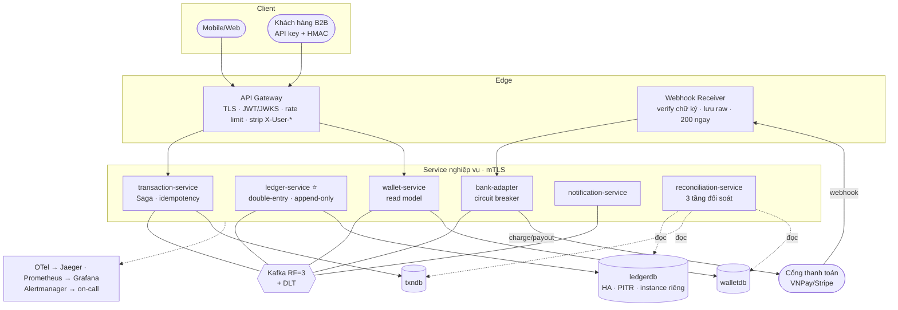

# WalletFlow — Lộ trình từ dự án học tập lên hệ thống chạy thật

> **Tài liệu này KHÔNG thay thế** [`walletflow-master-plan.md`](walletflow-master-plan.md).
> Master plan trả lời *"xây cái gì để học được bài toán khó"*.
> Tài liệu này trả lời *"còn thiếu gì để tiền thật chạy qua được, và làm theo thứ tự nào"*.
>
> **Ngày:** 2026-10-16 · **Trạng thái code:** M0 + M1 hoàn tất (~3.300 dòng Java)

---

## Mục lục

1. [Tóm tắt điều hành](#1-tóm-tắt-điều-hành)
2. [Đánh giá hiện trạng](#2-đánh-giá-hiện-trạng)
3. [Khoảng cách tới production (GAP register)](#3-khoảng-cách-tới-production-gap-register)
4. [Quyết định định vị sản phẩm — phải chốt trước Phase 2](#4-quyết-định-định-vị-sản-phẩm--phải-chốt-trước-phase-2)
5. [Nguyên tắc kỹ thuật bất biến](#5-nguyên-tắc-kỹ-thuật-bất-biến)
6. [Phase 0 — Siết nền móng](#phase-0--siết-nền-móng-10-ngày-công)
7. [Phase 1 — Hoàn thiện vòng tiền nội bộ](#phase-1--hoàn-thiện-vòng-tiền-nội-bộ-20-ngày-công)
8. [Phase 2 — Kết nối thế giới bên ngoài](#phase-2--kết-nối-thế-giới-bên-ngoài-20-ngày-công)
9. [Phase 3 — Đối soát & an toàn vận hành](#phase-3--đối-soát--an-toàn-vận-hành-15-ngày-công)
10. [Phase 4 — Production platform](#phase-4--production-platform-20-ngày-công)
11. [Phase 5 — Sản phẩm hoá & tuân thủ](#phase-5--sản-phẩm-hoá--tuân-thủ-dài-hạn)
12. [Kiến trúc đích](#12-kiến-trúc-đích)
13. [Ma trận rủi ro](#13-ma-trận-rủi-ro)
14. [Chi phí hạ tầng ước tính](#14-chi-phí-hạ-tầng-ước-tính)
15. [Nếu bạn chỉ có ít thời gian](#15-nếu-bạn-chỉ-có-ít-thời-gian)

---

## 1. Tóm tắt điều hành

| Phase | Tên | Ngày công | Mục tiêu một câu | Chạy thật được chưa? |
|---|---|---|---|---|
| **0** | Siết nền móng | 10 | Biến thứ đã có thành thứ **tin được** | Chưa — nhưng hết "nợ ngầm" |
| **1** | Vòng tiền nội bộ | 20 | Chuyển tiền P2P end-to-end qua API | Chạy được nội bộ (closed-loop) |
| **2** | Thế giới bên ngoài | 20 | Nạp/rút qua cổng thanh toán thật (sandbox) | Chạy được với tiền thật ở quy mô pilot |
| **3** | Đối soát & vận hành | 15 | Chứng minh mỗi ngày là tiền không sai | Đủ an toàn để có khách hàng |
| **4** | Production platform | 20 | K8s, HA, SLO, bảo mật hạ tầng | Đủ để cam kết uptime |
| **5** | Sản phẩm hoá | dài hạn | Multi-tenant, KYC/AML, SDK, giấy phép | Đủ để bán |

**Tổng tới hết Phase 4: ~85 ngày công** ≈ 17 tuần full-time, hoặc **~8 tháng part-time (10h/tuần)**.

Hai câu quan trọng nhất của tài liệu này:

> **1.** Đừng viết thêm service nào trước khi xong Phase 0. Mỗi service mới thêm vào một nền móng
> chưa siết sẽ nhân đôi khối lượng phải sửa lại.
>
> **2.** Thứ chặn bạn "chạy thật" **không phải là code**, mà là: đối soát (Phase 3), bảo mật khoá/bí
> mật (Phase 0), và giấy phép (Phase 5). Code chỉ chiếm ~60% quãng đường.

---

## 2. Đánh giá hiện trạng

### 2.1 Những thứ đã làm ĐÚNG (giữ nguyên, đừng động vào)

Phần ledger ở mức chất lượng cao hơn hẳn mặt bằng "project học tập". Cụ thể:

| Thứ | Ở đâu | Vì sao đáng giá |
|---|---|---|
| **Append-only cưỡng chế ở DB** | `V2__append_only_and_event_id.sql` — trigger chặn UPDATE/DELETE | Lời hứa bất biến không phụ thuộc vào kỷ luật của lập trình viên. Rất ít project làm tới mức này. |
| **Khoá theo thứ tự đã sắp xếp** | `LedgerService.resolveAccounts()` | `SELECT ... FOR UPDATE` theo `accountRef` đã sort → **không thể deadlock chéo**. Đây là chi tiết mà phần lớn người viết sẽ bỏ sót và trả giá lúc 2h sáng. |
| **Kiểm tra trùng 2 lần (trước & sau khi khoá)** | `LedgerService.postJournal()` | Xử lý đúng ca hai lệnh trùng chạy song song. |
| **Lệnh trùng TRẢ VỀ kết quả cũ, không ném lỗi** | cùng chỗ, có javadoc giải thích | Ném lỗi ở đây sẽ khiến Saga hiểu nhầm là "ghi sổ thất bại" → hoàn tiền một giao dịch đã vào sổ → **mất tiền thật**. Nhận ra được điều này là dấu hiệu hiểu hệ thống. |
| **Phân loại lỗi nghiệp vụ vs lỗi kỹ thuật** | `LedgerCommandListener` | Quyết định "retry hay compensate" dựa trên phân loại này. |
| **`Math.addExact` trong `Money`** | `Money.java` | Chặn ca `[MAX_VALUE, MAX_VALUE, 2]` cộng ra 0 và "cân bằng" giả. |
| **Outbox dùng `FOR UPDATE SKIP LOCKED`** | `JpaOutboxReader` | Relay scale ngang được mà không publish trùng. |
| **Test bằng Postgres + Kafka thật** | `LedgerServiceIT`, `OutboxRelayIT`, `LedgerCommandFlowIT` | Trigger append-only và `SKIP LOCKED` **không thể** test bằng H2/mock. |

Chất lượng comment tiếng Việt giải thích *"vì sao"* chứ không phải *"làm gì"* — giữ văn hoá này
cho các service sau.

### 2.2 Những thứ "trông như đã có" nhưng thực ra chưa

Đây là nhóm nguy hiểm nhất, vì tài liệu và javadoc đang nói là có:

| Tưởng là có | Thực tế |
|---|---|
| DLT cô lập poison message | Chỉ có **hằng số** `WalletTopics.DLT_SUFFIX` và javadoc nhắc tới. **Không có** `DefaultErrorHandler`/`DeadLetterPublishingRecoverer` nào được cấu hình → xem GAP-A1 (nghiêm trọng). |
| CI chạy Testcontainers | `.github/workflows/` **rỗng**. README mô tả pipeline chưa tồn tại. |
| Grafana dashboard | Chỉ có `datasources.yml`. Không có dashboard JSON, không có alert rule. |
| 8 ADR | Mới có **1** (`ADR-005`). |
| Database-per-service | Đúng về **logic** (5 database), nhưng cùng **một** container Postgres, một volume, không backup. |
| Rate limit cho lệnh tiền | Route `transaction-service`/`wallet-service` đã khai báo trong gateway nhưng service chưa tồn tại. |

---

## 3. Khoảng cách tới production (GAP register)

Mỗi GAP có mã để tham chiếu từ phần Phase bên dưới. Cột **Mức** = hậu quả nếu bỏ qua khi có tiền thật.

### A. An toàn tiền

| Mã | Khoảng cách | Mức | Xử lý ở |
|---|---|---|---|
| **A1** | **Không có DLT thật.** Mặc định của Spring Kafka là `DefaultErrorHandler` với `FixedBackOff(0, 9)`: thử 10 lần, rồi **log và commit offset**. Nghĩa là một `PostJournalCommand` gặp lỗi kỹ thuật kéo dài (DB down 1 phút) sẽ **biến mất âm thầm** — giao dịch treo vĩnh viễn ở `PENDING`, không ai biết. | 🔴 Mất lệnh tiền | Phase 0 |
| **A2** | Không có **available balance / HOLD**. Withdraw gửi lệnh ra ngân hàng rồi mới ghi sổ → trong khoảng chờ, user tiêu được số tiền đang rút. | 🔴 Double-spend | Phase 2 |
| **A3** | Không có job **đối soát**. Không có cách nào phát hiện read-model lệch ledger hay `SUM ≠ 0`. | 🔴 Sai tiền không ai biết | Phase 3 |
| **A4** | Ledger hỗ trợ `REVERSAL` nhưng **chưa ai gọi**. Không có quy trình hoàn/sửa giao dịch, không audit, không 4-eyes. | 🟠 Không sửa được sự cố | Phase 3 |
| **A5** | `outbox_event` không bao giờ được dọn; không có metric số hàng tồn đọng. | 🟠 Phình DB, mù lag | Phase 0 |
| **A6** | Mọi topup/withdraw đều khoá hàng `EXTERNAL_BANK` → **tuần tự hoá toàn hệ thống** ở các luồng này (đã được ghi nhận là đánh đổi có chủ ý trong javadoc). | 🟡 Trần throughput | Phase 4 |
| **A7** | Chưa có **phí (fee)**, chưa có hạn mức, chưa có multi-currency thực tế (chỉ seed VND). | 🟡 Thiếu nghiệp vụ | Phase 5 |

### B. Bảo mật

| Mã | Khoảng cách | Mức | Xử lý ở |
|---|---|---|---|
| **B1** | **JWT HS256 với secret đối xứng, giá trị mặc định đã commit** vào `auth/application.yml`, `gateway/application.yml` và `docker-compose.yml:146`. Ai đọc repo cũng ký được token với `role=ADMIN`. Thêm nữa: secret đối xứng nghĩa là **gateway cũng có quyền phát hành** token, không chỉ verify. | 🔴 Chiếm quyền | Phase 0 |
| **B2** | Access token sống **24 giờ**, không refresh token, không logout, không thu hồi. Mất token = mất ví trong 1 ngày. | 🔴 | Phase 0–1 |
| **B3** | `JwtAuthenticationFilter` **bỏ qua hoàn toàn** với path công khai → header `X-User-Id` do client tự gửi đi thẳng xuống downstream trên các path đó. Hiện chưa khai thác được (chưa có endpoint tiền công khai), nhưng quy tắc đúng là **strip vô điều kiện trên mọi path**. | 🟠 Bẫy chờ nổ | Phase 0 |
| **B4** | `spring.cloud.gateway.discovery.locator.enabled: true` → **mọi** service đăng ký Eureka tự động có đường vào qua `/{service-id}/**`, kể cả service không định public. | 🟠 | Phase 0 |
| **B5** | `ledger-service` map cổng `8083` ra host. Service nội bộ **tin tuyệt đối** header `X-User-*`. Lộ mạng = bypass xác thực hoàn toàn. | 🔴 | Phase 0 / 4 |
| **B6** | Không TLS, không mTLS, không network policy, không quản lý bí mật (Vault / External Secrets / SOPS). | 🔴 | Phase 4 |
| **B7** | Không audit log, không mã hoá PII, không chính sách mật khẩu / khoá tài khoản / MFA. | 🟠 | Phase 1, 5 |

### C. Dữ liệu & schema

| Mã | Khoảng cách | Mức | Xử lý ở |
|---|---|---|---|
| **C1** | `auth-service` dùng `ddl-auto: update`, **không Flyway** (`application.yml:18`). Schema prod sẽ do Hibernate tự suy diễn — không review được, không rollback được. | 🔴 | Phase 0 |
| **C2** | 5 database trong **1** container Postgres, 1 volume, **không backup, không PITR, không replica**. | 🔴 Mất toàn bộ sổ cái | Phase 0 (backup) → Phase 4 (HA) |
| **C3** | Kafka **1 node, RF=1**, `AUTO_CREATE_TOPICS_ENABLE=true`. Node chết = mất message chưa consume. Topic sai chính tả vẫn được tạo âm thầm. | 🔴 | Phase 4 (RF) / Phase 0 (tắt auto-create) |
| **C4** | Không có schema registry, không contract test giữa producer–consumer. | 🟠 | Phase 1–2 |

### D. Vận hành

| Mã | Khoảng cách | Mức | Xử lý ở |
|---|---|---|---|
| **D1** | **Không có CI.** Không gì ngăn code hỏng vào `master`. | 🔴 | Phase 0 |
| **D2** | Không dashboard, không alert rule. Prometheus có scrape nhưng không ai nhìn. | 🔴 Mù | Phase 0 → 3 |
| **D3** | Không K8s/Helm, không staging, không quy trình release/rollback. | 🟠 | Phase 4 |
| **D4** | Không runbook, không SLO, không on-call, chưa load test lần nào. | 🟠 | Phase 3–4 |
| **D5** | 1/8 ADR. | 🟡 | rải đều |

### E. Nghiệp vụ & pháp lý

| Mã | Khoảng cách | Mức | Xử lý ở |
|---|---|---|---|
| **E1** | **4/6 service chưa tồn tại** (wallet, transaction, bank-adapter, notification). Hiện **không có API nào chuyển được tiền** — ledger chỉ điều khiển được bằng cách bắn message Kafka tay. | 🔴 | Phase 1–2 |
| **E2** | Không KYC, không hạn mức theo hạng, không AML/sàng lọc, không chống gian lận. | 🔴 (nếu public) | Phase 5 |
| **E3** | **Giấy phép.** Cung cấp ví điện tử cho công chúng tại VN là dịch vụ trung gian thanh toán, cần giấy phép NHNN (khung: Nghị định 52/2024/NĐ-CP và thông tư hướng dẫn), kèm KYC/AML (Luật PCRT 2022) và bảo vệ dữ liệu cá nhân (NĐ 13/2023). Xử lý dữ liệu thẻ → PCI-DSS. *(Cần luật sư xác nhận — đây không phải tư vấn pháp lý.)* | 🔴 Chặn cứng | Phase 5 / §4 |

---

## 4. Quyết định định vị sản phẩm — phải chốt trước Phase 2

GAP-E3 không phải thứ "code xong rồi tính". Nó quyết định Phase 2 và Phase 5 trông như thế nào.
Có ba con đường, và chúng đòi hỏi những thứ **rất khác nhau**:

### Con đường A — Ví đóng (closed-loop) / số dư nội bộ

Ví chỉ tiêu được **trong hệ sinh thái của chính bạn**: credit SaaS, điểm thưởng, số dư nạp trước
cho hàng hoá của chính công ty, escrow cho marketplace do bạn vận hành.

- **Pháp lý:** nhẹ nhất. Tiền nạp vào là trả trước cho hàng hoá/dịch vụ của chính bạn, không phải
  "chuyển tiền cho bên thứ ba". **Vẫn cần kiểm tra:** nếu cho rút tiền mặt ra ngoài thì về bản chất
  đã là dịch vụ thanh toán.
- **Kỹ thuật:** Phase 0–3 là đủ. Phase 2 chỉ cần tích hợp **một cổng thanh toán có sẵn giấy phép**
  (VNPay / MoMo / Casso / Stripe) để nạp tiền — bạn không tự cầm tiền của người khác.
- **Thời gian tới "chạy thật": ~3–4 tháng part-time.**

### Con đường B — Hạ tầng ví / sổ cái bán cho doanh nghiệp (Wallet-as-a-Service) ⭐ **khuyến nghị**

Bạn bán **engine**, khách hàng của bạn là doanh nghiệp đã có giấy phép hoặc đang chạy mô hình
closed-loop. Tham chiếu thị trường: Formance, Increase, Moov, Fragment.

- **Pháp lý:** bạn là **nhà cung cấp phần mềm**, không cầm tiền → không cần giấy phép TGTT. Rủi ro
  pháp lý chuyển sang khách hàng.
- **Kỹ thuật:** đây là con đường tận dụng đúng thế mạnh sẵn có (ledger chất lượng cao). Thêm so với
  A: **multi-tenancy**, API key + ký HMAC request, webhook cho khách hàng, SDK, môi trường sandbox,
  tài liệu API công khai, SLA/SLO.
- **Lý do khuyến nghị:** phần khó nhất (sổ cái đúng, idempotency, outbox) **đã xong và làm tốt**;
  phần còn thiếu là phần làm được bằng kỹ thuật thuần. Không bị chặn bởi giấy phép, vốn pháp định,
  hay nhân sự tuân thủ.
- **Thời gian tới "bán được": ~8–10 tháng part-time.**

### Con đường C — Ví điện tử có giấy phép cho người dùng cuối

- **Pháp lý:** giấy phép TGTT của NHNN, vốn pháp định, tài khoản đảm bảo tại ngân hàng, nhân sự
  tuân thủ, kết nối báo cáo, eKYC, AML. Đây là bài toán **doanh nghiệp**, không phải bài toán
  kỹ thuật.
- **Thực tế:** không khả thi cho cá nhân/nhóm nhỏ. **Không nên chọn** trừ khi có pháp nhân và vốn.

### Khuyến nghị

> **Đi A trước như khách hàng đầu tiên của chính mình, kiến trúc theo B ngay từ Phase 1.**
>
> Cụ thể: từ Phase 1 đã thêm `tenant_id` vào mọi bảng và mọi event, dù ban đầu chỉ có một tenant.
> Thêm `tenant_id` lúc bảng rỗng tốn **1 giờ**. Thêm sau khi có dữ liệu thật tốn **1 tuần + một đêm
> downtime**.

Phần còn lại của tài liệu viết theo giả định này. Chỗ nào rẽ nhánh theo con đường sẽ được đánh dấu
🔀.

---

## 5. Nguyên tắc kỹ thuật bất biến

Mọi Phase phải tuân thủ. Vi phạm = chặn merge.

1. **Ledger là nguồn sự thật duy nhất về tiền.** Không service nào được có cột "số dư" mang tính
   quyết định. Mọi số dư khác là read model, phải **dựng lại được** từ ledger.
2. **Mọi lệnh ghi tiền phải idempotent theo một khoá tường minh.** Không dựa vào "chắc client không
   retry đâu".
3. **Mọi dual-write đi qua outbox.** Không có `repository.save()` rồi `kafkaTemplate.send()` trong
   cùng một hàm. Đây là thứ phải có linter/review bắt.
4. **Mỗi tính chất về tiền phải có một test chứng minh.** Phase nào không có test tương ứng thì
   Phase đó chưa xong — bất kể code đã chạy.
5. **Schema chỉ đổi bằng Flyway**, theo mẫu expand → backfill → contract. `ddl-auto` chỉ được là
   `validate` hoặc `none`.
6. **Không bí mật nào nằm trong repo**, kể cả giá trị mặc định cho dev. Thiếu biến môi trường thì
   **service phải không khởi động được**, không được âm thầm dùng default.
7. **Phân loại lỗi trước khi xử lý lỗi.** Lỗi nghiệp vụ → từ chối dứt khoát. Lỗi kỹ thuật → retry →
   DLT. Nhập nhằng hai loại này là cách mất tiền phổ biến nhất trong Saga.
8. **Mỗi quyết định kiến trúc = 1 ADR.** Viết lúc quyết định, không viết lúc tổng kết.

---

# PHASE 0 — Siết nền móng (10 ngày công)

> **Mục tiêu:** không thêm một tính năng nào. Biến thứ đã có thành thứ **tin được**, và dựng
> hàng rào để Phase 1–4 không tích thêm nợ.
>
> **Vì sao làm trước:** cả 4 service sắp viết đều sẽ dùng lại `common-lib`, cấu hình Kafka, mô hình
> bảo mật và CI. Sửa 1 chỗ bây giờ rẻ hơn sửa 5 chỗ sau.

## 0.1 — DLT thật (GAP-A1) · 1,5 ngày 🔴 **ưu tiên cao nhất toàn tài liệu**

Hiện tại một lệnh ghi tiền gặp lỗi kỹ thuật kéo dài sẽ bị **log rồi bỏ qua**. Đây là lỗ mất tiền
nghiêm trọng nhất đang tồn tại trong code.

**Việc cần làm:**

- Tạo `common-lib/src/main/java/com/walletflow/common/kafka/KafkaErrorHandlingConfig.java`:

```java
@Bean
DefaultErrorHandler kafkaErrorHandler(KafkaTemplate<String, String> template) {
    var recoverer = new DeadLetterPublishingRecoverer(template,
        (record, ex) -> new TopicPartition(record.topic() + WalletTopics.DLT_SUFFIX, record.partition()));

    var backOff = new ExponentialBackOffWithMaxRetries(5);   // ~0.5s → 8s
    backOff.setInitialInterval(500);
    backOff.setMultiplier(2.0);
    backOff.setMaxInterval(8_000);

    var handler = new DefaultErrorHandler(recoverer, backOff);
    // Lỗi parse/hình dạng message KHÔNG BAO GIỜ tự khỏi khi thử lại -> đi thẳng DLT (bài toán P9)
    handler.addNotRetryableExceptions(
        DeserializationException.class,
        MessageConversionException.class,
        BadRequestException.class);
    handler.setRetryListeners((rec, ex, attempt) ->
        log.warn("Kafka retry {} cho {}-{}@{}", attempt, rec.topic(), rec.partition(), rec.offset()));
    return handler;
}
```

- Tạo topic DLT **tường minh** (không dựa vào auto-create) qua `KafkaAdmin` + `NewTopic` bean.
- Metric: `walletflow_dlt_messages_total{topic}` (counter), tăng trong recoverer.
- **Tắt** `KAFKA_AUTO_CREATE_TOPICS_ENABLE` trong `docker-compose.yml`, khai báo topic bằng
  `KafkaAdmin` (GAP-C3 một phần).

**Test chứng minh:** `KafkaDltIT` — gửi một message có payload hỏng → khẳng định nó xuất hiện trên
`txn.command.post-journal.v1.DLT` sau đúng N lần thử, và **không** làm kẹt các message hợp lệ phía
sau trên cùng partition.

**DoD:** không có đường nào để một message biến mất mà không để lại dấu vết ở DLT hoặc ở ledger.

## 0.2 — Bí mật & khoá JWT (GAP-B1, B2) · 2 ngày 🔴

**Việc cần làm:**

- **Chuyển JWT sang bất đối xứng (RS256 hoặc EdDSA).** auth-service giữ private key và **ký**;
  gateway chỉ có public key và **verify**. Gateway mất quyền phát hành token.
- Expose `GET /.well-known/jwks.json` ở auth-service; gateway nạp JWKS, cache có TTL → **xoay khoá
  được mà không cần deploy đồng thời**. Thêm `kid` vào header token.
- Access token **15 phút**; thêm bảng `refresh_tokens` (hash của token, `expires_at`, `revoked_at`,
  `device_info`, `rotated_from`), refresh **xoay vòng + phát hiện tái sử dụng** (dùng lại refresh
  token cũ ⇒ thu hồi cả chuỗi).
- `POST /auth/logout` và `POST /auth/logout-all`.
- **Xoá mọi giá trị mặc định của bí mật** khỏi `application.yml` và `docker-compose.yml`. Dùng
  `${JWT_PRIVATE_KEY}` không có default → thiếu là app chết lúc khởi động. Thêm `.env.example`
  (chỉ có tên biến) và script `scripts/gen-keys.sh` sinh keypair cho dev.
- Thêm `git-secrets` hoặc `gitleaks` vào CI.

**Test chứng minh:** `AuthTokenIT` — token hết hạn bị từ chối; refresh xoay vòng hoạt động; dùng lại
refresh token cũ làm thu hồi toàn bộ chuỗi; token ký bằng khoá cũ bị từ chối sau khi xoay khoá.

**ADR-009:** Tại sao bất đối xứng + JWKS thay vì secret chia sẻ.

## 0.3 — Siết biên gateway (GAP-B3, B4, B5) · 0,5 ngày 🟠

- `JwtAuthenticationFilter`: **strip `X-User-*` do client gửi vào trên MỌI path**, kể cả path công
  khai, **trước** khi kiểm tra `isPublic()`. Nguyên tắc: header danh tính chỉ được sinh ra ở gateway,
  không bao giờ được đi vào từ ngoài.
- `discovery.locator.enabled: false` ở profile `prod` — chỉ route nào khai báo tường minh mới tồn tại.
- Bỏ `ports: 8083` của `ledger-service` khỏi compose mặc định; đưa sang `docker-compose.dev.yml`
  để debug.
- Thêm filter sinh/truyền `X-Request-Id` + `traceparent`; log JSON có `traceId` ở mọi service.

**Test chứng minh:** `GatewaySecurityIT` — request gửi kèm `X-User-Id: <id-người-khác>` tới cả path
công khai lẫn path được bảo vệ đều **không** làm downstream nhìn thấy giá trị đó.

## 0.4 — Flyway cho auth-service (GAP-C1) · 0,5 ngày 🔴

- `V1__init_auth.sql`: `users` (+ `email_ci` unique index trên `lower(email)`, `status`,
  `failed_login_count`, `locked_until`, `password_changed_at`), `refresh_tokens`, `audit_events`.
- `ddl-auto: validate`.
- Chính sách mật khẩu tối thiểu (độ dài ≥ 12, kiểm tra với danh sách mật khẩu phổ biến), khoá tài
  khoản tạm thời sau N lần sai (GAP-B7 một phần).

## 0.5 — Vệ sinh Outbox (GAP-A5) · 1 ngày

- Job dọn: xoá `published = true AND published_at < now() - 7 days`, chạy đêm, có cấu hình bật/tắt.
- Metrics: `walletflow_outbox_pending` (gauge), `walletflow_outbox_oldest_age_seconds` (gauge — đây
  mới là chỉ số phát hiện relay chết), `walletflow_outbox_published_total` (counter).
- Đặt `@SchedulerLock` (ShedLock trên Postgres) cho **job dọn** — relay thì đã an toàn nhờ
  `SKIP LOCKED` nên không cần.
- Index `idx_outbox_unpublished` nên là **partial index**: `WHERE published = false` — bảng sẽ toàn
  hàng đã publish, index đầy đủ là lãng phí.

**Test chứng minh:** `OutboxRetentionIT` — hàng đã publish quá hạn bị xoá, hàng chưa publish **không
bao giờ** bị đụng tới dù cũ cỡ nào.

## 0.6 — CI thật (GAP-D1) · 2 ngày 🔴

`.github/workflows/ci.yml`:

```yaml
jobs:
  verify:        # JDK 21 + cache Maven + mvn verify (có Testcontainers) + JaCoCo
  quality:       # Spotless check, SpotBugs, OWASP dependency-check, gitleaks
  images:        # matrix theo service -> build & push GHCR, tag = git sha
```

- **Quality gate:** JaCoCo ≥ 70% line coverage cho `common-lib` và `ledger-service`; build đỏ nếu tụt.
- Bật branch protection trên `master`: bắt buộc PR + CI xanh.
- `dependabot.yml` cho Maven + GitHub Actions.
- Badge build + coverage vào README (và **gỡ** phần README đang mô tả CI chưa tồn tại).

## 0.7 — Observability tối thiểu (GAP-D2) · 1,5 ngày

- Commit `deploy/grafana/dashboards/walletflow-overview.json`, provisioning tự nạp. Panel bắt buộc:
  outbox pending & tuổi hàng cũ nhất, DLT count, Kafka consumer lag, p50/p95/p99 theo endpoint,
  tỉ lệ lỗi 4xx/5xx, số bút toán/phút, JVM/GC.
- `deploy/prometheus/alerts.yml` — alert đầu tiên (tối thiểu 4 cái):
  `DltNotEmpty` (>0 trong 5 phút), `OutboxStalled` (hàng cũ nhất > 60s), `ConsumerLagHigh`,
  `ServiceDown`.
- Chuẩn hoá log JSON (logback) kèm `traceId`, `transactionId`, `tenantId`.

## 0.8 — Backup (GAP-C2 phần khẩn) · 0,5 ngày

Chưa cần HA, nhưng **phải có bản sao lưu ngay** — mất volume lúc này là mất toàn bộ sổ cái.

- Cron `pg_dump` mọi database → object storage, giữ 30 ngày.
- **Diễn tập khôi phục một lần** và ghi lại thời gian thực tế vào `docs/runbooks/restore.md`.
  Bản backup chưa từng restore thử thì chưa phải là backup.

## 0.9 — Viết nốt ADR (GAP-D5) · 0,5 ngày

ADR-001…004, 006…008 theo chỉ mục có sẵn trong master plan §24, cộng ADR-009 (JWT bất đối xứng).
Mỗi file ≤ 1 trang: Context → Decision → Consequences → Alternatives rejected.

### ✅ Definition of Done — Phase 0

- [ ] `mvn verify` xanh trên CI, bao gồm toàn bộ Testcontainers IT
- [ ] Không có bí mật nào trong repo; `gitleaks` xanh; thiếu env → service **không** khởi động
- [ ] Message lỗi đi vào DLT và có alert; không có đường nào mất message âm thầm
- [ ] `grep -r "ddl-auto: update"` không trả về kết quả
- [ ] Dashboard Grafana có số liệu thật; 4 alert rule hoạt động (thử bằng cách gây lỗi chủ động)
- [ ] Đã restore thành công một bản backup và ghi lại thời gian
- [ ] 9 ADR đầy đủ

---

# PHASE 1 — Hoàn thiện vòng tiền nội bộ (20 ngày công)

> **Mục tiêu:** `POST /api/v1/transactions/transfer` hoạt động end-to-end qua gateway, với
> idempotency, Saga, và read model số dư — tức là **ví dùng được** trong phạm vi closed-loop.
>
> Tương ứng M2 + M3 của master plan, nhưng nâng chuẩn lên mức production.

## 1.0 — Multi-tenancy từ đầu (🔀 bắt buộc nếu chọn con đường B) · 1,5 ngày

- Thêm `tenant_id UUID NOT NULL` vào **mọi** bảng nghiệp vụ, kể cả bảng ledger đã có → migration
  `V3__add_tenant.sql` (hiện ledger còn ít dữ liệu, làm bây giờ gần như miễn phí).
- Sửa unique key: `(tenant_id, transaction_id, type)` thay vì `(transaction_id, type)`;
  `(tenant_id, external_ref, currency)` cho `accounts`.
- `tenant_id` vào `EventEnvelope` và làm **một phần của partition key**.
- Hibernate `@Filter` hoặc Postgres RLS để chống rò rỉ chéo tenant; **mặc định phải là từ chối**.
- Giải phóng: tài khoản hệ thống (`EXTERNAL_BANK`, `FEE_INCOME`, `SETTLEMENT`) là **per-tenant**,
  không dùng chung.

**Test chứng minh:** `TenantIsolationIT` — truy vấn của tenant A **không bao giờ** thấy dữ liệu
tenant B, kể cả khi truyền thẳng ID của B; `SUM(postings) = 0` đúng **theo từng tenant**.

## 1.1 — wallet-service (:8082) · 5 ngày

**Vai trò:** read model, không phải nguồn sự thật.

- Schema `V1__init_wallet.sql`: `wallets(id, tenant_id, user_id, currency, balance_minor, held_minor,
  version, status, last_applied_event_id, created_at, updated_at)` + `processed_event`.
- Consume `ledger.event.posted.v1` → cập nhật `balance_minor` trong **cùng transaction** với
  `EventDeduplicator.markProcessed()` (đã có sẵn trong `common-lib`).
- `@Version` optimistic lock + Spring Retry cho `OptimisticLockException`.
- Cập nhật bằng **conditional UPDATE**, không read-modify-write:
  `UPDATE wallets SET balance_minor = balance_minor + :delta, version = version + 1 WHERE id = :id`.
- API: `GET /api/v1/wallets/me`, `GET /api/v1/wallets/me/transactions?cursor=&limit=`
  (**cursor-based**, không offset — offset pagination sẽ bỏ sót/lặp bản ghi khi có ghi đồng thời,
  và chậm dần với sổ giao dịch lớn).
- **`POST /admin/wallets/{id}/rebuild`** — dựng lại số dư từ ledger. Đây là chứng minh sống động
  rằng read model thực sự *suy ra được*, và là công cụ khôi phục khi projection hỏng.
- Trạng thái ví: `ACTIVE | FROZEN | CLOSED`; ví `FROZEN` bị ledger từ chối ghi nợ.

**Test chứng minh:**
- `WalletProjectionIT` — 100 event (có cả event lặp, có cả event tới sai thứ tự) → số dư cuối khớp
  chính xác `SUM(postings)` trong ledger.
- `WalletRebuildIT` — cố ý làm sai `balance_minor` → rebuild cho kết quả khớp ledger.
- `WalletConcurrencyIT` — 100 luồng cập nhật song song → không mất update nào.

## 1.2 — transaction-service (:8084) · 8 ngày ⭐ phần khó nhất của Phase

**Schema** `V1__init_txn.sql`:

```sql
CREATE TABLE idempotency_keys (
    tenant_id      UUID        NOT NULL,
    key            VARCHAR(64) NOT NULL,
    request_hash   VARCHAR(64) NOT NULL,     -- SHA-256 của body chuẩn hoá
    user_id        UUID        NOT NULL,     -- key của user A không đụng được giao dịch user B
    transaction_id UUID,
    response_body  JSONB,
    response_status SMALLINT,
    status         VARCHAR(16) NOT NULL,     -- IN_PROGRESS | COMPLETED
    created_at     TIMESTAMPTZ NOT NULL DEFAULT now(),
    expires_at     TIMESTAMPTZ NOT NULL,
    PRIMARY KEY (tenant_id, key)
);

CREATE TABLE transactions (
    id UUID PRIMARY KEY, tenant_id UUID NOT NULL, type VARCHAR(16) NOT NULL,
    status VARCHAR(20) NOT NULL, from_wallet UUID, to_wallet UUID,
    amount_minor BIGINT NOT NULL CHECK (amount_minor > 0), currency VARCHAR(3) NOT NULL,
    failure_code VARCHAR(32), failure_reason TEXT,
    created_at TIMESTAMPTZ NOT NULL DEFAULT now(), updated_at TIMESTAMPTZ NOT NULL DEFAULT now()
);

CREATE TABLE saga_state (
    transaction_id UUID PRIMARY KEY REFERENCES transactions(id),
    current_step VARCHAR(32) NOT NULL, step_status VARCHAR(16) NOT NULL,
    compensation_data JSONB, attempt_count INT NOT NULL DEFAULT 0,
    next_attempt_at TIMESTAMPTZ, deadline_at TIMESTAMPTZ NOT NULL,   -- phát hiện saga treo
    updated_at TIMESTAMPTZ NOT NULL DEFAULT now()
);
```

**Luật idempotency (chi tiết — đây là chỗ hay sai):**

| Tình huống | Phản hồi |
|---|---|
| Key mới | `INSERT ... status=IN_PROGRESS` → xử lý |
| Key cũ, `request_hash` **khớp**, `status=COMPLETED` | Trả lại `response_body` đã lưu, **không xử lý lại** |
| Key cũ, `request_hash` **khớp**, `status=IN_PROGRESS` | `409 Conflict` + `Retry-After` (đang chạy) |
| Key cũ, `request_hash` **khác** | `422` — client đang tái sử dụng key sai, đây là **bug phía client**, phải báo to |
| Key thuộc user khác | `404` (không tiết lộ sự tồn tại) |
| Key quá `expires_at` | Coi như key mới |

- **Saga orchestrator**: state machine tường minh (`PENDING → POSTING → COMPLETED / FAILED`), lưu
  bền vững sau **mỗi** bước → crash giữa chừng vẫn resume được.
- **Scheduler quét saga treo**: `deadline_at < now() AND status NOT IN (COMPLETED, FAILED)` →
  retry hoặc đẩy sang `MANUAL_REVIEW` + alert.
- Phát `PostJournalCommand` **qua outbox** (không gọi `kafkaTemplate` trực tiếp — nguyên tắc §5.3).
- Consume `ledger.event.posted.v1` / `rejected.v1` → chuyển trạng thái transaction.
- API: `POST /transactions/transfer` (202 + `transactionId`), `GET /transactions/{id}`.
- **Error model RFC 7807** (`application/problem+json`) thống nhất toàn hệ thống — sửa
  `GlobalExceptionHandler` trong `common-lib`.

**Test chứng minh (4 test đắt giá nhất của cả dự án):**
1. `IdempotencyIT` — gửi cùng key 2 lần (và 2 lần **song song**) → đúng **một** bút toán được ghi.
2. `SagaResumeIT` — giết service giữa saga (restart context) → saga tự hoàn tất sau khi sống lại,
   không tạo bút toán thừa.
3. `TransferConcurrencyIT` — 100 lệnh chuyển song song từ một ví có đủ tiền cho 10 lệnh → đúng 10
   thành công, số dư **không bao giờ** âm, `SUM(postings) = 0`.
4. `StuckSagaIT` — saga quá `deadline_at` → bị phát hiện và chuyển `MANUAL_REVIEW`, có alert.

## 1.3 — Contract test giữa event (GAP-C4) · 2 ngày

- Chốt schema event bằng **JSON Schema** commit trong `common-lib/src/main/resources/schemas/`.
- Test producer: event phát ra **phải** validate được với schema.
- Test consumer: parse được event ở mọi version đang hỗ trợ.
- Luật tiến hoá: chỉ thêm field optional; đổi phá vỡ ⇒ topic `.v2` + giai đoạn chạy song song.
- 🔀 Nếu đi con đường B: cân nhắc Schema Registry + Avro ở Phase 4 (khách hàng cần đảm bảo tương thích).

## 1.4 — notification-service (:8086) · 2 ngày

- Consume `txn.event.completed.v1` / `failed` → gửi thông báo (log/email mock, tách interface
  `NotificationChannel` để sau cắm provider thật).
- Có dedup (dùng lại `EventDeduplicator`) — **thông báo trùng là lỗi nhìn thấy được với người dùng**.
- Bảng `notifications` lưu lịch sử để tra cứu.

## 1.5 — Load test lần đầu · 1,5 ngày

- Script k6: `k6/transfer.js` — 50 → 500 VU, trộn ví nóng (cùng ví) và ví nguội (ví khác nhau).
- Ghi lại đường cơ sở: TPS, p50/p95/p99, tỉ lệ lỗi, outbox lag, consumer lag, số lần retry
  optimistic lock.
- **Commit kết quả vào `docs/benchmarks/phase1.md`** — có số cơ sở thì mới nói được "tối ưu" sau này
  có nghĩa gì.

### ✅ Definition of Done — Phase 1

- [ ] `curl POST /api/v1/transactions/transfer` qua gateway → tiền chuyển, số dư 2 ví đúng
- [ ] Gửi lại cùng `Idempotency-Key` → không trừ tiền lần hai
- [ ] Giết service giữa saga → giao dịch vẫn kết thúc đúng
- [ ] Rebuild projection cho kết quả khớp ledger 100%
- [ ] Tenant A không thấy được gì của tenant B
- [ ] Có số liệu load test cơ sở

---

# PHASE 2 — Kết nối thế giới bên ngoài (20 ngày công)

> **Mục tiêu:** nạp/rút tiền qua cổng thanh toán **thật ở môi trường sandbox**. Đây là lúc hệ thống
> lần đầu đối mặt với thứ nó không kiểm soát được.
>
> Tương ứng M4 của master plan, cộng phần webhook (master plan chưa đề cập nhưng là **phần khó
> nhất trong thực tế**).

## 2.1 — Mô hình HOLD / available balance (GAP-A2) · 3 ngày 🔴

Không có cái này thì không được mở luồng rút tiền. Trong lúc chờ ngân hàng xác nhận payout,
tiền phải bị **giữ**, nếu không user tiêu được số tiền đang rút.

**Thiết kế (dùng tài khoản trung gian, không dùng cột `held`):**

```
Withdraw 100k:
  Bước 1 — HOLD:    wallet A -100000  |  HOLD_A  +100000      (ghi sổ ngay)
  Bước 2a — payout thành công:  HOLD_A -100000  |  EXTERNAL_BANK +100000
  Bước 2b — payout thất bại:    HOLD_A -100000  |  wallet A     +100000   (REVERSAL)
```

**Vì sao dùng tài khoản trung gian thay vì cột `held_minor`:** mọi chuyển động tiền vẫn là bút toán
→ bất biến `SUM = 0` vẫn đúng, hold **vẫn kiểm toán được**, và không phải thêm đường ghi thứ hai vào
ledger. Một cột `held` là trạng thái nằm ngoài sổ cái — tức là một nguồn sự thật thứ hai, đúng thứ
mà nguyên tắc §5.1 cấm.

- `available_balance = SUM(postings của wallet)` — tự động đúng, không cần công thức riêng.
- Tài khoản `HOLD_<walletId>` tạo lazy khi cần.
- Report: tổng mọi tài khoản HOLD = tổng giao dịch đang treo → một chỉ số đối soát nữa.

**Test chứng minh:** `HoldIT` — đang có lệnh rút treo, ví không tiêu được phần tiền bị giữ; payout
fail → tiền quay về đủ; `SUM = 0` đúng ở cả ba trạng thái.

## 2.2 — bank-adapter (:8085) với kiến trúc provider · 5 ngày

- Interface `PaymentProvider`: `charge(ChargeRequest) → ChargeResult`,
  `payout(PayoutRequest) → PayoutResult`, `getStatus(providerRef)`, `refund(providerRef)`.
- **Hai implementation ngay từ đầu** — đây là điểm quan trọng:
  - `MockProvider` — có **fail injection theo cấu hình** (tỉ lệ lỗi, độ trễ, timeout, trả về sai
    thứ tự). Dùng cho test tự động và chaos test.
  - `VnPayProvider` / `StripeProvider` — sandbox thật. 🔀 Chọn theo con đường: A/B dùng cổng có sẵn
    giấy phép, không tự cầm tiền.
- Bảng `provider_transactions(id, tenant_id, provider, provider_ref UNIQUE, idempotency_key UNIQUE,
  type, amount_minor, status, raw_request JSONB, raw_response JSONB, created_at)`.
- **Adapter phải tự idempotent** theo key của chính nó — nếu không, saga retry bước charge sẽ
  charge thật hai lần.
- `Resilience4j`: circuit breaker + timeout + bulkhead (thread pool riêng) cho mọi call ra ngoài.
- **Không bao giờ log** số thẻ / CVV / token thanh toán. Thêm masking vào logback.

## 2.3 — Webhook ingestion · 4 ngày ⭐ phần thực tế hay làm hỏng nhất

Cổng thanh toán báo kết quả bằng webhook — và webhook thì **trùng lặp, đến muộn, và đến sai thứ tự**.

- Endpoint `POST /webhooks/{provider}` — **ngoài** luồng JWT (gateway có route riêng, rate limit theo IP).
- **Verify chữ ký** (HMAC/RSA tuỳ provider) **trước khi parse** body. Không verify được ⇒ `401` và
  **không** xử lý.
- Lưu **raw payload** vào `webhook_events` **trước khi** xử lý, trả `200` ngay, xử lý bất đồng bộ.
  Provider nào cũng timeout nhanh; xử lý đồng bộ trong webhook là nguyên nhân kinh điển của
  "provider retry 5 lần vì bạn trả lời chậm".
- **Chống replay:** `(provider, provider_event_id)` UNIQUE.
- **Xử lý webhook đến muộn:** ca ác nhất — bạn đã timeout và đánh `FAILED`, rồi 10 phút sau provider
  báo `SUCCESS`. Phải: phát hiện xung đột trạng thái → **không ghi đè mù** → đẩy vào
  `MANUAL_REVIEW` + alert, hoặc tự động ghi bút toán bù nếu luật nghiệp vụ cho phép.
- Nguyên tắc vàng: **webhook là gợi ý, không phải sự thật**. Với giao dịch quan trọng, luôn
  `getStatus(providerRef)` để xác nhận lại trước khi ghi sổ.

**Test chứng minh:** `WebhookIT` — chữ ký sai bị từ chối; webhook trùng chỉ ghi sổ một lần; webhook
success đến sau khi đã đánh fail → đi vào `MANUAL_REVIEW` chứ không âm thầm ghi đè.

## 2.4 — Saga top-up & withdraw có bù trừ · 5 ngày

**Top-up** (nạp): `PENDING → AWAITING_PAYMENT → (webhook) → POSTING → COMPLETED`
- Tiền chỉ vào ví **sau khi** ledger ghi xong, không phải khi nhận webhook.

**Withdraw** (rút): `PENDING → HOLDING → PAYOUT_SENT → (webhook) → SETTLING → COMPLETED`
- Compensation: payout fail → `REVERSAL` giải phóng HOLD về ví.
- Compensation **phải luôn thành công**: retry vô hạn với backoff; hết ngưỡng → `MANUAL_REVIEW` +
  alert nghiêm trọng (đây là lúc có người phải thức dậy).

**Test chứng minh:**
1. `TopupCompensationIT` — charge OK nhưng ledger từ chối → refund tự động chạy, ví không tăng.
2. `WithdrawCompensationIT` — HOLD xong, payout fail → tiền quay về ví đúng bằng số đã giữ.
3. `ChaosProviderIT` (Toxiproxy) — provider timeout/chập chờn → circuit breaker mở, saga không treo,
   không mất tiền.
4. `CompensationFailureIT` — refund fail liên tục → `MANUAL_REVIEW` + alert bắn.

## 2.5 — Admin API & manual review · 3 ngày

- `GET /admin/manual-review` — danh sách ca cần người can thiệp, có đủ ngữ cảnh (saga state,
  provider raw response, bút toán liên quan).
- `POST /admin/transactions/{id}/resolve` — ghi `REVERSAL` hoặc đánh dấu đã xử lý.
- **4-eyes**: thao tác đụng tiền cần **hai** tài khoản admin khác nhau phê duyệt (GAP-A4).
- Mọi thao tác admin ghi `audit_events` bất biến: ai, lúc nào, từ IP nào, trước/sau ra sao.
- RBAC: `ADMIN`, `OPS`, `AUDITOR` (chỉ đọc).

### ✅ Definition of Done — Phase 2

- [ ] Nạp tiền thật qua sandbox VNPay/Stripe → số dư tăng đúng
- [ ] Rút tiền → tiền bị giữ, không tiêu được, payout fail thì hoàn đủ
- [ ] Webhook trùng/muộn/sai chữ ký đều xử lý đúng
- [ ] Chaos test: provider chết 5 phút → không mất tiền, không saga treo
- [ ] Không có thao tác đụng tiền nào không để lại audit

---

# PHASE 3 — Đối soát & an toàn vận hành (15 ngày công)

> **Mục tiêu:** mỗi sáng có một báo cáo **chứng minh** tiền không sai. Đây là ranh giới thật giữa
> "hệ thống chạy được" và "hệ thống dám cho khách hàng dùng".

## 3.1 — Đối soát 3 tầng (GAP-A3) · 6 ngày 🔴

**Tầng 1 — Bất biến nội tại ledger** (chạy mỗi giờ):
```sql
SELECT tenant_id, currency, SUM(amount_minor) FROM postings p
JOIN journal_entries j ON p.entry_id = j.id GROUP BY 1, 2;   -- PHẢI = 0
```
Khác 0 ⇒ **báo động đỏ**, gọi người ngay. Tiền tự sinh hoặc bốc hơi.

**Tầng 2 — Read model vs sự thật** (chạy mỗi đêm): với mỗi ví,
`wallets.balance_minor == SUM(postings)`. Lệch ⇒ ghi `reconciliation_breaks`, alert, và **tự động
rebuild** projection (ledger luôn thắng).

**Tầng 3 — Đối soát ngoài** (mỗi đêm, sau khi provider chốt sổ): tải sao kê/settlement file của
provider → so từng giao dịch với `provider_transactions` **và** với ledger. Bốn loại lệch:
- provider có, ta không có → **tiền vào mà không ghi sổ** (nghiêm trọng nhất)
- ta có, provider không có → ghi sổ ảo
- cả hai có nhưng **số tiền khác** → sai số/phí
- cả hai có nhưng **trạng thái khác** → webhook lạc

**Bảng `reconciliation_runs` + `reconciliation_breaks`** (ngày, loại, số lượng, tổng chênh lệch,
trạng thái xử lý, người xử lý). **Break phải được đóng bởi người**, không tự biến mất.

**Metrics:** `walletflow_reconciliation_breaks{type}`, `walletflow_ledger_imbalance_minor`,
`walletflow_reconciliation_last_success_timestamp` (alert nếu job **không chạy** — job đối soát chết
âm thầm còn tệ hơn không có).

**Test chứng minh:** `ReconciliationIT` — cố ý làm lệch (UPDATE thẳng `wallets`, chèn
`provider_transactions` không có bút toán) → job phát hiện đúng loại, đúng số tiền, và alert bắn.

## 3.2 — Báo cáo & sổ sách · 2 ngày

- Sao kê ví theo kỳ (CSV/PDF), có số dư đầu kỳ / cuối kỳ / từng dòng — **số dư đầu kỳ + biến động =
  số dư cuối kỳ** phải luôn khớp.
- Trial balance theo ngày: mọi tài khoản + số dư, tổng = 0.
- Báo cáo settlement: tiền vào/ra qua từng provider theo ngày.
- 🔀 Con đường B: các báo cáo này là **tính năng bán được**, không phải phụ kiện.

## 3.3 — Công cụ vận hành · 3 ngày

- **DLT replay tool**: xem message trong DLT, sửa/replay có chọn lọc về topic gốc, có audit.
  (Không có công cụ này thì DLT chỉ là nơi chôn message.)
- `docs/runbooks/` — mỗi alert có **một** runbook: triệu chứng → chẩn đoán → cách xử lý → cách leo thang.
  Tối thiểu: `dlt-not-empty.md`, `outbox-stalled.md`, `reconciliation-break.md`,
  `saga-stuck.md`, `provider-down.md`, `restore.md`.
- Script điều tra: "giao dịch X đã đi qua những đâu" — gom log + trace + bút toán + provider response
  theo `transactionId`.

## 3.4 — Alert & SLO (GAP-D4) · 2 ngày

| SLI | SLO đề xuất |
|---|---|
| Tỉ lệ thành công API transfer | ≥ 99,9% / 30 ngày |
| p95 latency transfer (nội bộ) | < 300 ms |
| Độ trễ ledger→wallet projection | p99 < 5 s |
| Bất biến `SUM = 0` | **100%**, không có error budget |
| Thời gian đóng break đối soát | < 1 ngày làm việc |

- Error budget + chính sách: tiêu hết budget ⇒ dừng ra tính năng mới, chỉ sửa độ tin cậy.
- Alert phân tầng: `page` (gọi người) vs `ticket` (xem giờ hành chính). **Alert không hành động được
  thì phải xoá** — alert fatigue giết độ tin cậy nhanh hơn là không có alert.

## 3.5 — Diễn tập sự cố (game day) · 2 ngày

Làm thật, ghi lại thời gian thật:
1. Giết Postgres giữa giờ cao điểm → quan sát → khôi phục.
2. Giết Kafka 10 phút → outbox dồn → phục hồi → kiểm tra không mất/không trùng.
3. Xoá nhầm dữ liệu → restore từ backup → đo RTO/RPO thật.
4. Provider trả sai số tiền → đối soát bắt được không?

### ✅ Definition of Done — Phase 3

- [ ] Mỗi sáng có báo cáo đối soát, và **có người đọc nó**
- [ ] Mọi loại lệch đều được phát hiện bởi test chủ động gây lệch
- [ ] Mọi alert có runbook; đã diễn tập ít nhất 4 kịch bản sự cố
- [ ] RTO/RPO là **số đo được**, không phải số ước lượng

---

# PHASE 4 — Production platform (20 ngày công)

> **Mục tiêu:** chạy được 24/7 với cam kết uptime, bảo mật hạ tầng đúng chuẩn.

## 4.1 — Kubernetes + Helm (GAP-D3) · 6 ngày

- `deploy/k8s/charts/<service>/` — một chart dùng chung (library chart) + values theo service.
- Probes dùng Actuator: `readiness` = `/actuator/health/readiness` (phải **false** khi chưa kết nối
  được Kafka/DB), `liveness` = `/actuator/health/liveness`.
- `PodDisruptionBudget`, `topologySpreadConstraints`, resource requests/limits (đo từ load test
  Phase 1, không đoán).
- **HPA theo Kafka consumer lag bằng KEDA** — CPU không phải chỉ số đúng cho consumer.
- **Graceful shutdown**: `terminationGracePeriodSeconds` đủ dài để consumer commit offset và relay
  hoàn tất batch đang gửi.
- Migration chạy bằng **Job/initContainer**, không chạy lúc app khởi động (tránh N pod cùng migrate).

## 4.2 — Hạ tầng HA (GAP-C2, C3) · 5 ngày

- **Postgres**: managed (RDS/CloudSQL) hoặc CloudNativePG — replica đồng bộ, **PITR**, automated
  backup, connection pooling (PgBouncer). 🔀 Tách instance riêng cho `ledgerdb` — đây là tài sản
  quý nhất, không chia sẻ tài nguyên với cái khác.
- **Kafka**: managed (MSK/Confluent/Redpanda Cloud) hoặc tự vận hành ≥ 3 broker.
  **`replication.factor=3`, `min.insync.replicas=2`, `acks=all`** (client 3.x đã mặc định `acks=all`
  + idempotent producer — giữ nguyên, đừng hạ xuống). Retention cho topic lệnh tiền ≥ 7 ngày để
  replay được.
- **Redis**: có persistence hoặc chấp nhận mất (chỉ dùng cho rate limit — phải xác nhận không có
  trạng thái tiền nào nằm ở Redis).

## 4.3 — Bảo mật hạ tầng (GAP-B6) · 5 ngày

- **TLS ở mọi nơi**: Ingress (cert-manager + Let's Encrypt), TLS cho Postgres và Kafka.
- **mTLS giữa service** — service mesh (Linkerd nhẹ hơn Istio cho quy mô này) hoặc tối thiểu
  `NetworkPolicy` default-deny + allowlist. Mục tiêu: **downstream không còn tin header một cách mù
  quáng** — danh tính gateway được chứng minh bằng cert.
- **Quản lý bí mật**: External Secrets Operator + AWS Secrets Manager / Vault. Tự động xoay khoá JWT
  (đã chuẩn bị từ Phase 0 nhờ JWKS + `kid`).
- Image scanning (Trivy) trong CI; **distroless** base image; chạy non-root, read-only filesystem.
- Pentest (tự làm theo OWASP ASVS, hoặc thuê nếu có khách hàng thật).

## 4.4 — CD & môi trường · 3 ngày

- 3 môi trường: `dev` (compose) → `staging` (k8s, dữ liệu giả) → `prod`.
- GitOps (ArgoCD) hoặc GitHub Actions deploy; **prod cần phê duyệt thủ công**.
- Rollback một lệnh; migration theo **expand–contract** để rollback app không vỡ schema.
- Feature flag cho tính năng đụng tiền → bật dần theo tenant/% user.
- Smoke test tự động sau deploy: nạp–chuyển–rút một giao dịch nhỏ thật trên prod, kiểm tra
  `SUM = 0`, rồi reverse.

## 4.5 — Tối ưu (GAP-A6) · 1 ngày+

Chỉ làm **sau khi** load test chỉ ra nghẽn thật:
- Tách nostro `EXTERNAL_BANK` thành nhiều tài khoản theo provider/shard để giảm tranh chấp khoá.
- Partition bảng `postings` theo tháng khi dữ liệu lớn.
- Read replica cho truy vấn lịch sử/báo cáo.

### ✅ Definition of Done — Phase 4

- [ ] Giết 1 pod bất kỳ lúc cao điểm → không giao dịch nào lỗi
- [ ] Deploy giữa giờ làm việc không gây downtime; rollback < 5 phút
- [ ] Không có bí mật nào trong image hay manifest
- [ ] Load test đạt mục tiêu TPS với p95 trong SLO
- [ ] Có 30 ngày dữ liệu SLO liên tục

---

# PHASE 5 — Sản phẩm hoá & tuân thủ (dài hạn)

> Từ đây trở đi, thứ tự phụ thuộc vào **khách hàng thật nói gì**. Danh sách dưới đây là kho công
> việc, không phải hàng đợi tuần tự.

## 5.1 — 🔀 Nếu đi con đường B (WaaS) — ~30 ngày công

- **Multi-tenant hoàn chỉnh**: onboarding tenant tự phục vụ, quota/hạn mức theo gói, cô lập tài
  nguyên (connection pool, consumer group, rate limit riêng), báo cáo theo tenant.
- **API dành cho máy**: API key + **ký HMAC request** (không dùng JWT của người dùng cuối cho
  server-to-server), chống replay bằng timestamp + nonce.
- **Webhook ra cho khách hàng**: ký payload, retry có backoff, DLQ riêng, trang xem lịch sử & replay.
- **SDK**: Java + Node/TS tối thiểu. Sinh từ OpenAPI.
- **Sandbox công khai**: dữ liệu giả, provider mock, API key test — khách hàng tự thử trước khi ký.
- **Tài liệu API công khai**: OpenAPI + hướng dẫn tích hợp + **cookbook các ca khó** (xử lý webhook
  trùng, idempotency, đối soát). Với hạ tầng tài chính, **tài liệu chính là sản phẩm**.
- Trang trạng thái (status page) + lịch sử sự cố công khai.

## 5.2 — Nghiệp vụ tài chính nâng cao — ~25 ngày công

- **Fee engine**: phí theo loại giao dịch/tenant/hạng, ghi vào `FEE_INCOME` **như một vế của chính
  bút toán đó** (không phải bút toán riêng — nếu không, phí và giao dịch có thể lệch nhau).
- **Multi-currency + FX**: tài khoản theo currency (đã có), thêm bút toán quy đổi qua tài khoản
  `FX_POSITION`, tỉ giá có version và thời điểm hiệu lực. **Không bao giờ** cộng hai currency.
- Chuyển tiền định kỳ, chi hàng loạt (batch payout), yêu cầu thanh toán, QR.
- Escrow / thanh toán có điều kiện (giải ngân khi đủ điều kiện).
- Hạn mức theo hạng: ngày/tháng/mỗi giao dịch, theo tenant và theo user.

## 5.3 — KYC / AML / Chống gian lận (GAP-E2) — ~25 ngày công 🔀 bắt buộc nếu A hoặc C

- eKYC (tích hợp VNPT eKYC / FPT.AI / Onfido): định danh, đối chiếu khuôn mặt, lưu bằng chứng.
- Hạng tài khoản theo mức KYC, hạn mức tương ứng.
- Sàng lọc danh sách cấm vận/PEP khi onboarding và định kỳ.
- **Giám sát giao dịch**: luật phát hiện bất thường (velocity, structuring/chia nhỏ, tài khoản mule,
  giao dịch vòng tròn), hàng đợi case cho đội tuân thủ.
- Lưu trữ hồ sơ theo quy định (thường 5–10 năm) — thiết kế lưu trữ lạnh, **ledger vốn đã bất biến
  nên phần này dễ**.

## 5.4 — Dữ liệu cá nhân & lưu trữ · liên tục

- Mã hoá PII ở mức trường (email, số điện thoại, CMND) với khoá quản lý tập trung.
- **Xung đột cốt lõi: "quyền được xoá" vs sổ cái bất biến.** Lời giải chuẩn: ledger **chỉ chứa
  pseudonym** (`wallet_id`), PII nằm ở service riêng và xoá được. Xoá người dùng = xoá bản đồ
  `wallet_id → người thật`, giữ nguyên bút toán. **Thiết kế hiện tại đã đúng hướng này** —
  `accounts.external_ref` là `wallet_id`, không phải thông tin cá nhân. Đừng phá vỡ nó.
- Chính sách lưu trữ theo loại dữ liệu; ghi lại căn cứ pháp lý cho từng loại xử lý (NĐ 13/2023).

## 5.5 — Giấy phép (GAP-E3) · 🔀 chỉ con đường A (nếu cho rút ra ngoài) hoặc C

Tư vấn luật sư fintech **trước khi** mở cho người dùng công khai. Khung cần xác nhận: Nghị định
52/2024/NĐ-CP về thanh toán không dùng tiền mặt và thông tư hướng dẫn của NHNN, Luật Phòng chống rửa
tiền 2022, Nghị định 13/2023/NĐ-CP về bảo vệ dữ liệu cá nhân, PCI-DSS nếu chạm dữ liệu thẻ.
*(Đây không phải tư vấn pháp lý.)*

---

## 12. Kiến trúc đích



**Khác biệt chính so với master plan gốc:**
- Thêm **Webhook Receiver** tách khỏi luồng JWT (master plan chưa có — nhưng đây là nơi tiền thật
  đi vào).
- Thêm **reconciliation-service** như một thành phần riêng, không phải một `@Scheduled` nằm nhờ.
- Thêm **HOLD account** trong ledger (master plan §5.4 để ngỏ).
- `tenant_id` xuyên suốt mọi service và mọi event.

---

## 13. Ma trận rủi ro

| Rủi ro | Khả năng | Hậu quả | Giảm thiểu | Phase |
|---|---|---|---|---|
| Message lệnh tiền mất âm thầm (chưa có DLT) | **Cao** | Giao dịch treo vĩnh viễn, mất tiền | DLT + alert + replay tool | 0 |
| Bí mật JWT lộ trong repo | **Đã xảy ra** | Chiếm quyền toàn hệ thống | Khoá bất đối xứng + JWKS + xoá default | 0 |
| Mất volume Postgres | Trung bình | **Mất toàn bộ sổ cái — không khôi phục được** | Backup + diễn tập restore → HA + PITR | 0 → 4 |
| Double-spend khi rút tiền | Cao (khi mở luồng) | Mất tiền trực tiếp | HOLD account | 2 |
| Webhook đến muộn ghi đè trạng thái | **Rất cao** | Sai trạng thái, sai tiền | Phát hiện xung đột → manual review | 2 |
| Provider sai lệch sổ sách | Trung bình | Lệch tiền tích luỹ | Đối soát 3 tầng hằng ngày | 3 |
| Nghẽn khoá `EXTERNAL_BANK` | Trung bình | Trần throughput topup/withdraw | Shard nostro | 4 |
| Vận hành một mình, không ai trực | **Cao** | Sự cố kéo dài qua đêm | Alert phân tầng + runbook + (sau) on-call | 3 |
| Chưa có giấy phép mà mở public | — | **Rủi ro pháp lý nghiêm trọng** | Chọn con đường A/B; tư vấn luật sư | 4–5 |

---

## 14. Chi phí hạ tầng ước tính

| Giai đoạn | Hạ tầng | Chi phí/tháng |
|---|---|---|
| Phase 0–1 (dev) | Máy local + GitHub Actions free | **~0 USD** |
| Phase 2–3 (pilot) | 1 VPS 8GB + managed Postgres nhỏ + object storage backup | **~40–80 USD** |
| Phase 4 (prod nhỏ) | K8s managed (3 node) + Postgres HA + Kafka managed + monitoring | **~300–600 USD** |
| Phase 5 (có khách) | + replica, WAF, log retention, status page, pentest | **~800–2.000 USD** |

Mẹo giảm chi phí giai đoạn đầu: Redpanda thay Kafka (nhẹ RAM hơn nhiều), Hetzner/Contabo thay AWS,
Grafana Cloud free tier.

---

## 15. Nếu bạn chỉ có ít thời gian

**Có 2 tuần:** làm hết Phase 0. Đây là ROI cao nhất tuyệt đối — và nếu mục tiêu vẫn còn là CV/phỏng
vấn thì "tôi phát hiện DLT chỉ tồn tại trong javadoc nên message lỗi bị bỏ qua âm thầm, và đã sửa"
là một câu chuyện kỹ thuật mạnh hơn bất kỳ tính năng mới nào.

**Có 2 tháng:** Phase 0 + Phase 1. Kết quả: ví closed-loop chạy end-to-end, có CI, có test chứng
minh idempotency + concurrency + saga resume. Đủ để demo cho khách hàng đầu tiên.

**Có 6 tháng:** Phase 0 → 3. Đây là mốc **"dám cho tiền thật chạy qua"** — vì đã có đối soát hằng
ngày và quy trình xử lý sự cố.

**Thứ tự ưu tiên trong Phase 0 nếu phải cắt:** `0.1 (DLT)` → `0.2 (bí mật/JWT)` → `0.6 (CI)` →
`0.8 (backup)` → phần còn lại.

---

## Phụ lục — Checklist bắt đầu ngay hôm nay

```bash
# 1. Tạo branch cho Phase 0
git checkout -b feat/phase-0-hardening

# 2. Ba việc đầu tiên, theo đúng thứ tự:
#    a) common-lib: KafkaErrorHandlingConfig + DLT + test chứng minh message lỗi vào DLT
#    b) scripts/gen-keys.sh + chuyển JWT sang RS256 + xoá mọi secret mặc định khỏi repo
#    c) .github/workflows/ci.yml chạy được `mvn verify` với Testcontainers

# 3. Sửa README: gỡ những phần mô tả thứ chưa tồn tại (CI, dashboard, 8 ADR)
#    — tài liệu nói quá về hiện trạng là một dạng nợ kỹ thuật nguy hiểm riêng.
```

---

*Tài liệu sống. Cập nhật sau mỗi Phase: cái gì ước lượng sai, cái gì phát sinh, GAP nào mới xuất hiện.*
